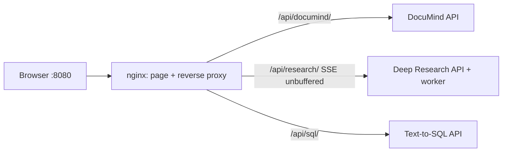

# AI Portfolio

Three production-style GenAI (Generative AI) projects built on a shared
platform layer. Together they go from retrieval, to coordinating agents,
to a conversational agent.

| # | Project | Stack | Summary |
|---|---------|-------|---------|
| 0 | [aicore](packages/aicore/) | Python | Shared platform layer: LLM (Large Language Model) clients, retries, tracing, cost, caching, guardrails, evals |
| 1 | [DocuMind](projects/01-documind/) | Flask, Postgres + pgvector | RAG (Retrieval-Augmented Generation) over documents: hybrid retrieval and reranking, cited answers, refusals, guardrails, HTTP (HyperText Transfer Protocol) API (Application Programming Interface) in Docker |
| 2 | [Deep Research](projects/02-deep-research/) | FastAPI + LangGraph + Redis | Multi-agent system: planner, parallel researchers, writer and critic produce a cited report; runs as a job service with a Redis queue, worker and live SSE (Server-Sent Events) progress (done) |
| 3 | [Text-to-SQL Agent](projects/03-text-to-sql-agent/) | Flask + LangGraph + Postgres | Conversational chatbot over a SQL (Structured Query Language) database: multi-turn memory in Postgres, three-layer read-only execution, self-correction, execution-accuracy evals, chat API in Docker (done) |

## Try all three in a browser

One URL for the whole portfolio: a plain HTML page behind an nginx
gateway that forwards `/api/documind/`, `/api/research/` and `/api/sql/`
to the three APIs (ADR 0021).

```bash
cp .env.example .env    # set AICORE_* (DocuMind needs the Cloudflare embedding model)
docker compose -f infra/docker-compose.yml up web
# open http://localhost:8080
```



Tabs: **DocuMind** (answer with citations or a refusal), **Deep
Research** (live progress, then the cited report), **Text-to-SQL chat**
(answer, with the SQL and result table on demand). Measured through the
gateway on Cloudflare models: DocuMind 3.1 s, a Text-to-SQL turn 3–4 s,
a Deep Research report 18 s.

## Quickstart

```bash
uv sync --all-packages                    # install all workspace members
docker compose -f infra/docker-compose.yml up -d   # Postgres+pgvector, Redis, Langfuse
uv run pytest                             # run tests
```
