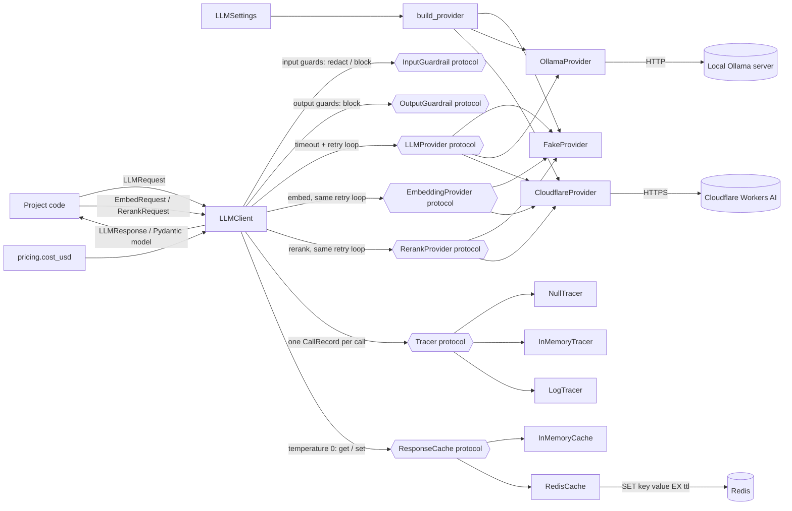
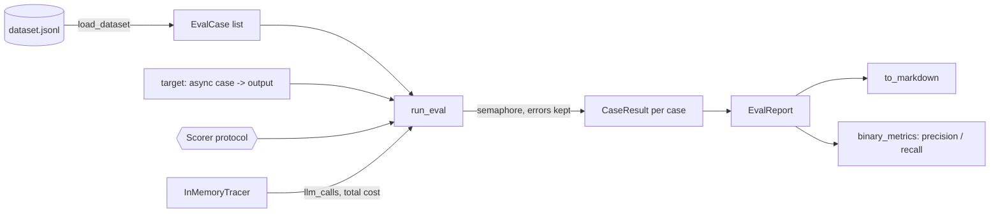

# aicore

Shared platform layer used by all five portfolio projects. Every LLM
(Large Language Model), embedding and reranker call in the portfolio
goes through `aicore`, so
reliability, tracing, cost tracking and caching are built once and behave
the same everywhere.

## Status

| Milestone | Scope | State |
|---|---|---|
| M0 | Workspace, tooling, CI (Continuous Integration) skeleton | done |
| M1 | Provider-agnostic LLM client: retries, timeouts, structured output | done |
| M1.5 | Ollama adapter (local models) and provider factory | done |
| M1.6 | Cloudflare Workers AI adapter (hosted, free tier) | done |
| M2 | Observability and cost tracking | done |
| M2.5 | Langfuse exporter | parked |
| M3 | Response caching (in-memory and Redis) | done |
| M3.5 | Guardrails: PII redaction, input limits, injection and secret-leak checks | done |
| M4 | Evaluation harness: datasets, scorers, runner, reports, eval gate | done |
| M5 | Embeddings and reranking (for project 01, DocuMind) | done |

## Problem

Each project needs to call an LLM. If every project calls a vendor SDK
(Software Development Kit) directly, then:

- retries, timeouts and error handling get re-implemented (and drift) per project;
- switching vendors means touching every call site;
- unit tests need network access or ad-hoc mocks.

## Architecture



- **`LLMProvider`** (`providers/base.py`): a `typing.Protocol` with a
  `name` attribute (for example `"ollama"`) and one method,
  `async complete(request) -> LLMResponse`. Adapters only translate
  to and from a vendor API (Application Programming Interface) and map vendor
  errors onto aicore's error types.
- **`LLMClient`** (`client.py`): the single entry point. It adds a timeout on
  every attempt, retries with exponential backoff and full jitter, and
  provides structured output.
- **`EmbeddingProvider` / `RerankProvider`** (`providers/base.py`):
  separate protocols, because not every backend offers every capability
  (Ollama has no rerank endpoint). `LLMClient` takes them as optional
  `embedder=` and `reranker=` arguments.
- **`FakeProvider`** (`providers/fakeai.py`): a scripted, offline provider
  for tests and local development. It records every request in `.calls`
  (and `.embed_calls`, `.rerank_calls`). It embeds with the hashing trick
  (texts sharing words get similar vectors) and reranks by word overlap,
  so retrieval tests run offline with meaningful rankings.
- **`OllamaProvider`** (`providers/ollama.py`): calls a local Ollama
  server's `/api/chat` with `httpx` and maps HTTP (Hypertext Transfer
  Protocol) status codes and network failures onto aicore errors.
- **`CloudflareProvider`** (`providers/cloudflare.py`): calls Workers
  AI's native `/ai/run/{model}` endpoint with `httpx` for chat, embedding
  (`@cf/baai/bge-base-en-v1.5`) and reranking (`@cf/baai/bge-reranker-base`). It reads
  Cloudflare's error codes as well as the status, so a used-up daily
  quota is not retried. The status mapping shared with Ollama lives in
  `providers/_http.py`.
- **`build_provider`** (`providers/factory.py`): reads
  `settings.provider` and returns the matching adapter. It is the only
  place that knows every adapter.
- **Errors** (`errors.py`): `RetryableError` (rate limit, timeout,
  unavailable) and `NonRetryableError` (for example, authentication or
  `QuotaExhaustedError`). Only retryable errors are retried.
- **Tracing** (`tracing.py`): after every call, `LLMClient` sends one
  `CallRecord` to a `Tracer`. Tracers: `NullTracer` (default, drops
  records), `InMemoryTracer` (tests), `LogTracer` (one JSON line per call
  on the `aicore.trace` logger).
- **Pricing** (`pricing.py`): `cost_usd(provider, usage)` turns reported
  usage into US dollars.
- **Guardrails** (`guardrails.py`): `InputGuardrail` and
  `OutputGuardrail` protocols, run inside `LLMClient`, plus four
  built-in guards (see below).
- **Caching** (`cache.py`, `redis_cache.py`): a `ResponseCache` protocol
  with `InMemoryCache` (tests) and `RedisCache` (shared between
  processes, entries expire after a TTL (time to live)).
- **Evaluation** (`evals/`): golden datasets, scorers, a concurrent
  runner, Markdown reports and precision/recall for detectors (see
  [Evaluation harness](#evaluation-harness)).

## Usage

```python
import asyncio

from pydantic import BaseModel

from aicore.client import LLMClient
from aicore.models import LLMRequest, Message
from aicore.providers.fakeai import FakeProvider


class Book(BaseModel):
    """Target shape for the structured reply."""

    title: str
    year: int


async def main() -> None:
    """Run one plain and one structured call against the fake provider."""
    provider = FakeProvider(script=["Hello!", '{"title": "Dune", "year": 1965}'])
    client = LLMClient(provider)
    request = LLMRequest(messages=[Message(role="user", content="Hi")])

    reply = await client.complete(request)
    print(reply.text)  # Hello!

    book = await client.complete_structured(request, Book)
    print(book)  # title='Dune' year=1965


asyncio.run(main())
```

### Using a real provider

```python
from aicore.client import LLMClient
from aicore.config import LLMSettings
from aicore.providers.factory import build_provider

settings = LLMSettings()  # AICORE_PROVIDER=ollama in .env
provider = build_provider(settings)
client = LLMClient(provider, settings)
```

Ollama setup: install it, run `ollama pull qwen2.5:0.5b`, then set
`AICORE_MODEL=qwen2.5:0.5b`. On a CPU-only (Central Processing Unit)
laptop, the first call loads the model into RAM (Random Access Memory)
and can take 10–30 s, so raise `AICORE_TIMEOUT_S` (for example, to 120).

Cloudflare setup: create a free account and an API token with
**Workers AI: Read** permission. Then set `AICORE_PROVIDER=cloudflare`,
`AICORE_MODEL=@cf/meta/llama-3.1-8b-instruct`, `AICORE_API_KEY=<token>`
and `AICORE_CLOUDFLARE_ACCOUNT_ID=<account id>`. The free plan allows
10,000 neurons per day and stops (no charge) when they run out; it
resets at 00:00 UTC (Coordinated Universal Time).

### Embedding and reranking

```python
from aicore.client import LLMClient
from aicore.models import EmbedRequest, RerankRequest
from aicore.providers.cloudflare import CloudflareProvider

provider = CloudflareProvider(account_id, api_token)
client = LLMClient(provider, settings, embedder=provider, reranker=provider)

docs = await client.embed(EmbedRequest(texts=chunks))  # input_type="document"
query = await client.embed(EmbedRequest(texts=[question], input_type="query"))
ranked = await client.rerank(RerankRequest(query=question, documents=chunks, top_n=5))
best = [chunks[r.index] for r in ranked.results]  # highest score first
```

- **`input_type` states intent; the adapter adds the prefix.** BGE
  (BAAI General Embedding) queries get "Represent this sentence for
  searching relevant passages: "; documents get none.
- **Results point back by `index`**, so the caller keeps its own chunk
  metadata.
- Embed and rerank share `complete()`'s timeout, retry and backoff
  behaviour and send one trace record each. Guards and the response
  cache do not apply to them.
- A client built without `embedder=` (or `reranker=`) raises
  `InvalidRequestError` when `embed()` (or `rerank()`) is called.
- **Rerank scores are raw and uncalibrated** (0.049 vs 0.032 in a live
  test). Use them to order results, not as a fixed threshold.

## Configuration

Settings are read from environment variables (or a `.env` file) with the
prefix `AICORE_`. They are validated at startup.

| Variable | Default | Meaning |
|---|---|---|
| `AICORE_PROVIDER` | `fake` | Which adapter to use: `fake`, `ollama` or `cloudflare` |
| `AICORE_MODEL` | `fake-model` | Model used when a request does not set one |
| `AICORE_EMBED_MODEL` | `fake-model` | Embedding model when an `EmbedRequest` does not set one (Cloudflare: `@cf/baai/bge-base-en-v1.5`) |
| `AICORE_RERANK_MODEL` | `fake-model` | Rerank model when a `RerankRequest` does not set one (Cloudflare: `@cf/baai/bge-reranker-base`) |
| `AICORE_API_KEY` | unset | Provider key or token (Cloudflare API token), stored as a `SecretStr` so it is never printed |
| `AICORE_TIMEOUT_S` | `30.0` | Timeout per attempt, in seconds |
| `AICORE_MAX_RETRIES` | `3` | Retries after the first attempt (so 4 calls at most) |
| `AICORE_OLLAMA_BASE_URL` | `http://localhost:11434` | Root URL of the Ollama server |
| `AICORE_CLOUDFLARE_ACCOUNT_ID` | unset | Cloudflare account ID; required when the provider is `cloudflare` |
| `AICORE_CACHE_TTL_S` | `86400` | Seconds a cached reply lives in Redis (one day) |

## Reliability behaviour

- **Retries:** only `RetryableError` is retried. A permanent error, such as a
  bad API key, is raised immediately because resending the request cannot
  fix it.
- **Backoff:** full jitter. The delay is a random value between 0 and
  `min(max_delay, base_delay * 2^attempt)`. The randomness keeps many clients
  from retrying in lockstep.
- **`Retry-After`:** if a provider says how long to wait, that value is used
  instead of the computed backoff.
- **Timeouts:** applied to each attempt, not to the whole call. A hung
  attempt becomes `ProviderTimeoutError` and is retried.
- **Structured output:** the JSON (JavaScript Object Notation) Schema of the
  target Pydantic model goes in as a system message. The reply is stripped
  of Markdown code fences and then validated. A reply with the wrong shape
  raises `StructuredOutputError`, which keeps the raw text. It is **not**
  retried.

## Tracing and cost

Pass a tracer to the client to get one record per call:

```python
import logging

from aicore.client import LLMClient
from aicore.tracing import LogTracer

logging.basicConfig(level=logging.INFO)
client = LLMClient(provider, settings, tracer=LogTracer())
```

Each call then logs one line like this:

```text
INFO:aicore.trace:{"call_id":"5280bf...","provider":"fake","model":"fake-model",
"started_at":"2026-11-13T12:57:25.544689Z","latency_ms":0.12,"attempts":1,
"outcome":"ok","usage":{"input_tokens":1,"output_tokens":1,"neurons":null},
"cost_usd":0.0}
```

| Field | Meaning |
|---|---|
| `call_id` | Random ID, to match a log line to a trace later |
| `operation` | `complete`, `embed` or `rerank` |
| `provider` | Name reported by the provider object that served the call |
| `model` | Model that actually served the call (Cloudflare may route to a variant) |
| `started_at` | Start time, timezone-aware UTC |
| `latency_ms` | Whole call, including retries and backoff sleeps |
| `attempts` | Attempts made (1 = no retry; 0 = cache hit) |
| `outcome` | `ok`, or the error class name, for example `RateLimitError` |
| `cached` | `true` when the reply came from the response cache |
| `usage` | Tokens (and Cloudflare neurons); `null` when the call failed |
| `cost_usd` | Cost in US dollars; `null` when unknown or failed |

Rules:

- **Exactly one record per call**: success, final failure, permanent
  error or cancellation.
- **Tracing never breaks a call.** If building or sending the record
  fails, a warning is logged and the real result is returned.
- **Cost:** Ollama and the fake provider cost `0.0` (no per-call bill).
  Cloudflare costs neurons × USD 0.011 per 1,000 neurons, its paid-plan
  list price; the free plan's 10,000 neurons per day are not charged. A
  provider with no known price gets `null`, never `0`.
- Cloudflare's embed and rerank endpoints report no neurons, so their
  `cost_usd` is `null` (unknown), not `0`.
- `complete_structured` is traced through `complete`. A reply that fails
  validation is still `outcome="ok"`, because the transport succeeded.

## Response caching

Pass a cache to the client. Requests with `temperature == 0` (the
default) are then answered from the cache when the same request was
seen before:

```python
from aicore.client import LLMClient
from aicore.redis_cache import RedisCache

cache = RedisCache.from_url("redis://localhost:6379/0", settings.cache_ttl_s)
client = LLMClient(provider, settings, cache=cache)
...
await cache.aclose()  # on shutdown
```

Start Redis with `docker compose -f infra/docker-compose.yml up -d redis`.

Rules:

- **Exact match.** The key is a SHA-256 (Secure Hash Algorithm) hash of
  the provider name and the whole request (messages, model, temperature,
  `max_tokens`, ...), prefixed `aicore:v1:`. The default model is filled
  in before hashing, so changing `AICORE_MODEL` never reuses old replies.
- **Only `temperature == 0`** is cached; sampled replies are meant to vary.
- **A broken cache is a miss.** Redis down or a corrupt entry is logged
  as a warning and the provider is called; the corrupt entry is then
  overwritten with the fresh reply.
- **Only successful replies are stored.**
- **Hits are traced** with `cached=true`, `attempts=0` and `cost_usd=0.0`.

## Guardrails

Pass guards to the client. Input guards run in order, each on the
previous one's result; put `MaxInputChars` first so oversized text is
rejected before the other guards scan it:

```python
from aicore.guardrails import InjectionHeuristic, MaxInputChars, PIIRedactor, SecretLeakGuard

client = LLMClient(
    provider,
    settings,
    input_guards=[MaxInputChars(40_000), PIIRedactor(), InjectionHeuristic()],
    output_guards=[SecretLeakGuard()],
)
```

| Guard | Runs on | Action |
|---|---|---|
| `MaxInputChars(n)` | request | Blocks if all messages together exceed `n` characters (about 4 per English token) |
| `PIIRedactor()` | request | Replaces emails, phone numbers and Luhn-valid card numbers with `[EMAIL]`, `[PHONE]`, `[CARD]` in user and assistant messages; system messages are kept |
| `InjectionHeuristic()` | request | Blocks user messages with known injection phrases ("ignore previous instructions", "reveal your system prompt", ...) |
| `SecretLeakGuard()` | reply | Blocks replies containing credential formats (AWS (Amazon Web Services) keys, GitHub tokens, `sk-` keys, private keys, JWTs (JSON Web Tokens), ...) |

A blocked call raises `GuardrailError` (not retried) with `.guard` and
`.reason`; the reason never contains the offending text. `redact_pii`
is also usable on its own, for example to clean logs.

Order inside `complete()`:

```text
input guards -> cache key -> cache lookup -> provider (on a miss)
             -> output guards -> cache write -> return
```

- PII (Personally Identifiable Information) is redacted before the
  cache key is built, so it never reaches the provider, the traces or
  Redis.
- A reply blocked by an output guard is never cached; output guards
  also run on cache hits.
- A blocked call is traced once with `outcome="GuardrailError"`. An
  output block keeps its usage and cost, because the provider was paid.
- `InjectionHeuristic` and `SecretLeakGuard` accept `extra_patterns`
  (`(label, regex)` pairs) so a project can add rules.

**Limits.** These are fast filters, not guarantees. The injection
check misses paraphrases, other languages and encoded text; real
protection is least privilege and checking what the model's output can
trigger. The PII regexes miss formats such as `(415) 555-0123`, names
and addresses, and can flag a 10-digit timestamp as a phone number. See
[ADR 0006](../../docs/adr/0006-guardrails.md).

### Guardrail overhead (measured)

`scripts/measure_guards.py` runs all four guards on one request and its
reply, median of 200 runs, 2026-11-14, same laptop:

| Input | Size | Time |
|---|---|---|
| Short chat message | 99 chars | 0.04 ms |
| RAG (Retrieval-Augmented Generation) prompt | 3,960 chars | 1.5 ms |
| Large RAG context | 39,600 chars | 14.6 ms |
| Worst case: digits and spaces | 40,000 chars | 33.0 ms |

- Time grows linearly with size, including the worst case, so there is
  no ReDoS (Regular expression Denial of Service).
- Against an 800 ms provider call, that is 0.005% for chat and about 2%
  for a 10,000-token prompt.

```powershell
uv run python scripts/measure_guards.py
```

## Evaluation harness

Every project measures quality with the same small harness, before any
tuning. It has no dependencies beyond Pydantic.



```python
from aicore.client import LLMClient
from aicore.evals.dataset import load_dataset
from aicore.evals.models import EvalCase
from aicore.evals.report import to_markdown
from aicore.evals.runner import run_eval
from aicore.evals.scorers import Contains
from aicore.models import LLMRequest, Message
from aicore.tracing import InMemoryTracer

tracer = InMemoryTracer()
client = LLMClient(provider, settings, tracer=tracer)


async def answer(case: EvalCase) -> str:
    """The system under test: one LLM call per case."""
    request = LLMRequest(messages=[Message(role="user", content=case.input)])
    return (await client.complete(request)).text


# inside an async function:
cases = load_dataset("evals/questions.jsonl")
report = await run_eval("qa-baseline", cases, answer, [Contains()], tracer=tracer)
print(to_markdown(report))
```

| Part | What it does |
|---|---|
| `load_dataset` | Reads JSONL (JSON Lines), one `EvalCase(id, input, expected, tags)` per line; errors name `file:line`; duplicate ids and empty files are rejected |
| `ExactMatch` | Equal after normalising case, spacing and a trailing period; labels and dicts compared as JSON |
| `Contains` | Every expected substring is in the answer; partial credit in `value` |
| `JSONValid(schema)` | Output fits a Pydantic schema (shape only) |
| `NumericClose` | Number within a tolerance; accepts "1,234.5" and "1,23,456" |
| `run_eval` | Runs the target with at most `concurrency` cases at once; a target error fails that case only |
| `EvalReport` | Pass rate (overall and per scorer), errors, p50/p95 latency, LLM calls, total cost |
| `binary_metrics` | Precision and recall for yes/no detectors |

### Measured: injection heuristic

`packages/aicore/evals/injection.jsonl` holds 30 hand-written prompts:
16 attacks (direct phrasing, Unicode disguise, indirect, paraphrase,
role-play, Hindi, Hinglish, base64, spaced letters) and 14 benign
prompts, 9 of which look suspicious. Measured on 2026-11-16:

| Metric | Value |
|---|---|
| Precision (blocked prompts that were attacks) | 0.73 (8 of 11) |
| Recall (attacks blocked) | 0.50 (8 of 16) |
| False positives (benign prompts blocked) | 3 of 14 |
| Latency p50 / p95 | 0.01 ms / 0.04 ms |

- Every direct, Unicode-disguised and indirect attack is caught; every
  paraphrase, Hindi, base64 and spaced-out attack gets through.
- The false positives are innocent questions containing a trigger
  phrase, for example "how do I show the system prompt path in Windows
  cmd?".
- The gate test asserts precision ≥ 0.72 and recall ≥ 0.50, so a change
  that weakens the guard fails `pytest`.

```powershell
uv run pytest -m eval -s   # run the gate and print the full report
```

See [ADR 0007](../../docs/adr/0007-evaluation-harness.md) for the design
and the full per-attack-type table.

## Latency and cost (measured)

`scripts/measure_llm.py` sends the same short prompt ("In one sentence,
what is a vector database?", `max_tokens=64`) 5 times through
`LLMClient` and reads the trace records. "Cold" is the first call (model
load for Ollama; connection setup for Cloudflare); "warm" is the median
of calls 2–5. Measured on 2026-11-13 on a CPU-only (Central Processing
Unit) Windows laptop.

| Provider | Model | Cold | Warm median | Tokens in/out | Neurons per call | Cost per call | Cost per 1,000 calls |
|---|---|---|---|---|---|---|---|
| Ollama (local) | `qwen2.5:0.5b` | 4,820 ms | 1,414 ms | 39 / 26 | n/a | USD 0 | USD 0 |
| Cloudflare Workers AI | `@cf/meta/llama-3.1-8b-instruct` | 1,489 ms | 563 ms | 45 / 44 | 1.72 | USD 0.000019 | USD 0.019 |

Reading the numbers:

- The hosted 8B (8 billion parameter) model answers about 2.5× faster than
  a 0.5B model on a laptop CPU, despite the network round trip.
- At about 1.7 neurons per call, the free plan covers roughly 5,800 such
  calls per day.
- This is a latency and cost comparison only. The two models differ 16×
  in size, so answer quality is not compared here; that needs a task
  dataset run through the evaluation harness.
- Five calls is a small sample: use these numbers as an order of
  magnitude, not a benchmark.

Reproduce:

```powershell
$env:AICORE_PROVIDER="cloudflare"; $env:AICORE_MODEL="@cf/meta/llama-3.1-8b-instruct"
uv run python scripts/measure_llm.py 5
```

### Cache hit vs miss

With `REDIS_URL` set, the script uses `RedisCache`. A random tag in the
prompt makes call 1 a real miss; calls 2–6 are hits. Measured on
2026-11-14, Redis 7 in Docker Desktop on the same laptop, Cloudflare
`@cf/meta/llama-3.1-8b-instruct`, 6 calls:

| | Latency | Cost per call |
|---|---|---|
| Miss (provider call) | 798 ms | USD 0.0000175 |
| Hit (median of 5) | 1.3 ms | USD 0 |

- A hit is roughly 600× faster and uses no neurons.
- With the fake provider, the miss still took about 110 ms: that is the
  first Redis connection being opened, not the provider. A long-running
  service should open the connection at startup.

```powershell
$env:REDIS_URL="redis://localhost:6379/0"
uv run python scripts/measure_llm.py 6
```

## Ollama error mapping

| Failure | aicore error | Retried? |
|---|---|---|
| Connection refused / network error | `ProviderUnavailableError` | yes |
| HTTP client timeout | `ProviderTimeoutError` | yes |
| 429 | `RateLimitError` (reads `Retry-After` seconds) | yes |
| 5xx | `ProviderUnavailableError` | yes |
| 401 / 403 | `AuthenticationError` | no |
| 404 (unknown model) and other 4xx | `InvalidRequestError` | no |

## Cloudflare error mapping

| Failure | aicore error | Retried? |
|---|---|---|
| Network error / HTTP client timeout | `ProviderUnavailableError` / `ProviderTimeoutError` | yes |
| 429, code 3040 (temporary capacity limit) | `RateLimitError` | yes |
| 429, code 3036 (daily allowance used up) | `QuotaExhaustedError` | no |
| 5xx | `ProviderUnavailableError` | yes |
| 401 / 403 | `AuthenticationError` | no |
| Other 4xx, or `success: false` on a 2xx | `InvalidRequestError` | no |

## How to run the tests

From the workspace root:

```powershell
uv run pytest -v
uv run ruff check .
uv run ruff format --check .
uv run mypy
```

Unit tests use `FakeProvider`, `httpx.MockTransport` or `InMemoryCache`,
so they need no network access and no API key. Integration tests are
skipped by default. They call a local Ollama, Redis (from Docker
Compose) and, if credentials are set, the real Cloudflare API (a few
neurons per run). Each one skips itself when its service is not
reachable:

```powershell
uv run pytest -m integration -v
```

Eval gate tests (`@pytest.mark.eval`) are offline and also run in the
default `pytest` run; `uv run pytest -m eval -s` runs only them and
prints their reports.

## Trade-offs and future work

- Two real adapters: Ollama (local) and Cloudflare Workers AI (hosted).
  Gemini is parked.
- Only Cloudflare code 3036 is special-cased; other codes use the shared
  status mapping.
- The `LLMProvider` protocol has no `aclose`, so code holding a plain
  `LLMProvider` cannot close an HTTP adapter's connection pool. This
  will be fixed when a long-running service needs clean shutdown.
- `Retry-After` in HTTP-date form is ignored; the computed backoff is
  used instead.
- Validation failures are not retried. A "repair" retry, which sends the
  validation error back to the model, may be added once eval data shows it
  is worth the extra cost.
- No trace UI (User Interface) yet: the Langfuse exporter is M2.5.
- The neuron price is a hard-coded list price and can go stale. There is
  no per-token price table yet; it arrives with the first token-billed
  provider.
- The cache is exact-match only. A semantic cache (matching similar
  prompts by embedding) is deferred until a paraphrase dataset can
  measure how often it would return a wrong answer.
- Guardrails are regex-based. An NER (Named Entity Recognition) model or
  Microsoft Presidio would catch names and addresses. An LLM-as-judge
  injection check can now be compared against the heuristic on
  `injection.jsonl`.
- The eval harness has no LLM-as-judge scorer, no per-case cost, no
  baseline comparison and no CI (Continuous Integration) workflow yet;
  see ADR 0007 for why each was deferred.
- `CallRecord` does not yet name the guard that fired, and secrets in
  the *input* are not checked.
- No cache stampede protection: two processes that miss at the same
  moment both call the provider.
- Cached replies sit in Redis as plain text; prompts with personal or
  secret data need a short TTL or no cache.
- Embeddings: no embedding cache, no batch splitting for Cloudflare's
  per-call limit, no Ollama embedding adapter, and no cost estimate for
  Cloudflare embed/rerank yet. See ADR 0008.
- See [ADR 0001](../../docs/adr/0001-provider-interface.md) for why the
  client is built around a provider protocol, and
  [ADR 0002](../../docs/adr/0002-ollama-adapter-raw-httpx.md) for why the
  Ollama adapter uses raw `httpx`, and
  [ADR 0003](../../docs/adr/0003-cloudflare-workers-ai-adapter.md) for the
  Cloudflare adapter and its error-code mapping, and
  [ADR 0004](../../docs/adr/0004-tracing-and-cost.md) for tracing and
  cost tracking, and
  [ADR 0005](../../docs/adr/0005-response-caching.md) for response
  caching, and
  [ADR 0006](../../docs/adr/0006-guardrails.md) for guardrails, and
  [ADR 0007](../../docs/adr/0007-evaluation-harness.md) for the
  evaluation harness, and
  [ADR 0008](../../docs/adr/0008-embeddings-and-reranking.md) for
  embeddings and reranking.