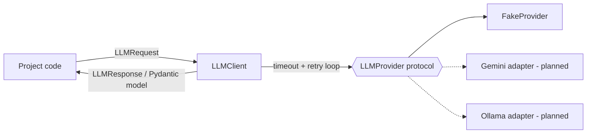

# aicore

Shared platform layer used by all five portfolio projects. Every LLM
(Large Language Model) call in the portfolio goes through `aicore`, so
reliability, tracing, cost tracking and caching are built once and behave
the same everywhere.

## Status

| Milestone | Scope | State |
|---|---|---|
| M0 | Workspace, tooling, CI (Continuous Integration) skeleton | done |
| M1 | Provider-agnostic LLM client: retries, timeouts, structured output | done |
| M2 | Observability and cost tracking | planned |
| M3 | Caching and guardrails | planned |
| M4 | Evaluation harness | planned |

## Problem

Each project needs to call an LLM. If every project calls a vendor SDK
(Software Development Kit) directly, then:

- retries, timeouts and error handling get re-implemented (and drift) per project;
- switching vendors means touching every call site;
- unit tests need network access or ad-hoc mocks.

## Architecture



- **`LLMProvider`** (`providers/base.py`): a `typing.Protocol` with one
  method, `async complete(request) -> LLMResponse`. Adapters only translate
  to and from a vendor API (Application Programming Interface) and map vendor
  errors onto aicore's error types.
- **`LLMClient`** (`client.py`): the single entry point. It adds a timeout on
  every attempt, retries with exponential backoff and full jitter, and
  provides structured output.
- **`FakeProvider`** (`providers/fakeai.py`): a scripted, offline provider
  for tests and local development. It records every request in `.calls`.
- **Errors** (`errors.py`): `RetryableError` (rate limit, timeout,
  unavailable) and `NonRetryableError` (for example, authentication). Only
  retryable errors are retried.

## Usage

```python
import asyncio

from pydantic import BaseModel

from aicore.client import LLMClient
from aicore.models import LLMRequest, Message
from aicore.providers.fakeai import FakeProvider


class Book(BaseModel):
    """Target shape for the structured reply."""

    title: str
    year: int


async def main() -> None:
    """Run one plain and one structured call against the fake provider."""
    provider = FakeProvider(script=["Hello!", '{"title": "Dune", "year": 1965}'])
    client = LLMClient(provider)
    request = LLMRequest(messages=[Message(role="user", content="Hi")])

    reply = await client.complete(request)
    print(reply.text)  # Hello!

    book = await client.complete_structured(request, Book)
    print(book)  # title='Dune' year=1965


asyncio.run(main())
```

## Configuration

Settings are read from environment variables (or a `.env` file) with the
prefix `AICORE_`. They are validated at startup.

| Variable | Default | Meaning |
|---|---|---|
| `AICORE_PROVIDER` | `fake` | Which adapter to use |
| `AICORE_MODEL` | `fake-model` | Model used when a request does not set one |
| `AICORE_API_KEY` | unset | Provider key, stored as a `SecretStr` so it is never printed |
| `AICORE_TIMEOUT_S` | `30.0` | Timeout per attempt, in seconds |
| `AICORE_MAX_RETRIES` | `3` | Retries after the first attempt (so 4 calls at most) |

## Reliability behaviour

- **Retries:** only `RetryableError` is retried. A permanent error, such as a
  bad API key, is raised immediately because resending the request cannot
  fix it.
- **Backoff:** full jitter. The delay is a random value between 0 and
  `min(max_delay, base_delay * 2^attempt)`. The randomness keeps many clients
  from retrying in lockstep.
- **`Retry-After`:** if a provider says how long to wait, that value is used
  instead of the computed backoff.
- **Timeouts:** applied to each attempt, not to the whole call. A hung
  attempt becomes `ProviderTimeoutError` and is retried.
- **Structured output:** the JSON (JavaScript Object Notation) Schema of the
  target Pydantic model goes in as a system message. The reply is stripped
  of Markdown code fences and then validated. A reply with the wrong shape
  raises `StructuredOutputError`, which keeps the raw text. It is **not**
  retried.

## How to run the tests

From the workspace root:

```powershell
uv run pytest -v
uv run ruff check .
uv run ruff format --check .
uv run mypy
```

All tests use `FakeProvider`, so they need no network access and no API key.

## Trade-offs and future work

- No vendor adapter yet. Gemini, Ollama and Cloudflare adapters come next.
- Validation failures are not retried. A "repair" retry, which sends the
  validation error back to the model, may be added once eval data shows it
  is worth the extra cost.
- Latency and cost numbers will be added in M2, when tracing lands.
- See [ADR 0001](../../docs/adr/0001-provider-interface.md) for why the
  client is built around a provider protocol.