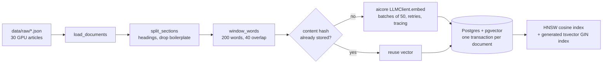

# DocuMind

Question answering over documents with cited sources, built as a RAG
(Retrieval-Augmented Generation) service.

**Stack:** Python 3.12, Flask, Postgres + pgvector, embeddings through
[`aicore`](../../packages/aicore) (Cloudflare Workers AI, BGE (BAAI General
Embedding) `bge-base-en-v1.5`).

_Status: M2 (ingestion) done. Retrieval, evals and the API follow._

## Problem

An LLM (Large Language Model) can't answer reliably about documents it
has never seen, and it can't say where an answer came from. DocuMind
retrieves the relevant passages first and answers from them with
citations. This README covers step one: turning a folder of documents
into searchable chunks.

## Architecture (ingestion)



| Module | Job |
|---|---|
| `corpus.py` | Load and validate `{"title", "url", "text"}` JSON documents |
| `chunking.py` | Section-aware chunks; each is embedded as `Title > Section\ntext` |
| `pipeline.py` | Embed only unseen chunks; replace each document atomically |
| `store.py` | Schema, `init_db`, `PgChunkStore` (psycopg 3 async) |
| `cli.py` | `documind init-db`, `documind ingest` |

## How to run

```bash
# 1. Postgres with pgvector (from the repo root)
docker compose -f infra/docker-compose.yml up -d postgres

# 2. Configure: copy .env.example to .env, then set
#    AICORE_PROVIDER=cloudflare, AICORE_EMBED_MODEL=@cf/baai/bge-base-en-v1.5,
#    AICORE_API_KEY and AICORE_CLOUDFLARE_ACCOUNT_ID
uv sync --all-packages

# 3. Create the database and schema, then ingest
uv run documind init-db
uv run documind ingest
```

Tests: `uv run pytest projects/01-documind`. The integration tests
(`-m integration`) need Postgres running and skip themselves without it.
They use separate `documind_test` and `documind_e2e` databases with an
offline fake embedder, so they never touch real data or call Cloudflare.

## Ingestion numbers

Corpus: 30 documents, 105k words → **888 chunks** (median 124 words,
max 200).

| Run | Embedded | Reused | Embed calls |
|---|---|---|---|
| Fresh ingest (from an empty database) | 888 | 0 | 34 |
| Re-run, nothing changed | 0 | 888 | 0 |

Each embed call of up to 50 chunks took 0.2–0.5 s on Cloudflare Workers
AI. Re-runs are free: a chunk's vector is reused whenever its exact text
was embedded before, in any document.

**Chunk size was measured against the model limit.** BGE reads at most
512 tokens and silently drops the rest. The first version used 300-word
chunks. Embedding the longest chunks one per call showed some at exactly
512 tokens, so they were being truncated. Table-heavy sections run at
about 1.9 tokens per word. At 200 words the densest prose chunk is 400
tokens. See [ADR 0009](../../docs/adr/0009-documind-ingestion.md).

## Design decisions

- **Chunks never cross a section heading**, and boilerplate (References,
  See also, External links) is dropped. One vector covers one topic.
- **40-word overlap**: a sentence cut at a window edge appears whole in
  the next chunk.
- **A header goes into the embedding**: `CUDA > History\n…` tells the
  model what "it was released in 2007" refers to.
- **Content-hash reuse plus delete-and-reinsert per document**: re-runs
  cost nothing, edits re-embed only the changed chunks, and a crash
  loses at most one document.
- **A generated `tsvector` column** is maintained by Postgres, ready for
  keyword and hybrid search in M4.

## Trade-offs and future work

- Word windows avoid a tokenizer dependency, but the safe size must be
  re-measured for denser corpora.
- Cloudflare bills a batch as (texts × longest text). Length-sorted
  batches would lower billed tokens; not needed on the free tier.
- 43 chunks under 20 words (table residue) are kept until evals (M3)
  show whether they hurt retrieval.
- Next: golden dataset and evals (M3), then dense, hybrid and reranked
  retrieval measured against it (M4).
