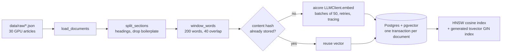
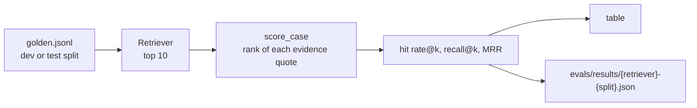
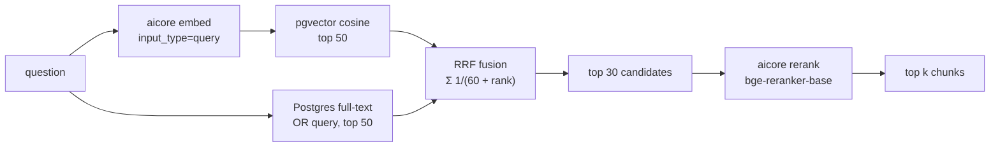

# DocuMind

Question answering over documents with cited sources, built as a RAG
(Retrieval-Augmented Generation) service.

**Stack:** Python 3.12, Flask, Postgres + pgvector, embeddings and
reranking through [`aicore`](../../packages/aicore) (Cloudflare Workers AI,
BGE (BAAI General Embedding) `bge-base-en-v1.5` and `bge-reranker-base`).

_Status: M4 (hybrid retrieval and reranking) done. Cited answers and the
API follow._

## Problem

An LLM (Large Language Model) can't answer reliably about documents it
has never seen, and it can't say where an answer came from. DocuMind
retrieves the relevant passages first and answers from them with
citations. So far this README covers turning a folder of documents into
searchable chunks, finding the right ones for a question, and measuring
how well that works.

## Architecture (ingestion)



| Module | Job |
|---|---|
| `corpus.py` | Load and validate `{"title", "url", "text"}` JSON documents |
| `chunking.py` | Section-aware chunks; each is embedded as `Title > Section\ntext` |
| `pipeline.py` | Embed only unseen chunks; replace each document atomically |
| `store.py` | Schema, `init_db`, `PgChunkStore` (psycopg 3 async) |
| `retrieval.py` | `Retriever` protocol; dense, sparse (Postgres full-text), hybrid (RRF) and reranking retrievers; `build_retriever` |
| `golden.py` | Golden dataset models, loader and quote validator |
| `metrics.py` | Hit rate@k, recall@k, MRR (Mean Reciprocal Rank) from evidence ranks |
| `evaluate.py` | Runs the golden questions through a retriever; table + saved JSON |
| `cli.py` | `documind init-db`, `documind ingest`, `documind eval` |

## How to run

```bash
# 1. Postgres with pgvector (from the repo root)
docker compose -f infra/docker-compose.yml up -d postgres

# 2. Configure: copy .env.example to .env, then set
#    AICORE_PROVIDER=cloudflare, AICORE_EMBED_MODEL=@cf/baai/bge-base-en-v1.5,
#    AICORE_RERANK_MODEL=@cf/baai/bge-reranker-base,
#    AICORE_API_KEY and AICORE_CLOUDFLARE_ACCOUNT_ID
uv sync --all-packages

# 3. Create the database and schema, then ingest
uv run documind init-db
uv run documind ingest

# 4. Score retrieval on the golden questions (dev split, hybrid-rerank by default)
uv run documind eval --split dev
uv run documind eval --split dev --retriever dense   # or sparse, hybrid, dense-rerank
```

Run the commands from the repo root: `.env` is read from the current
directory. Elsewhere the settings fall back to the offline fake provider;
the query-dimension check then stops the run with a clear error instead
of searching with the wrong vectors.

Tests: `uv run pytest projects/01-documind`. The integration tests
(`-m integration`) need Postgres running and skip themselves without it.
They use separate `documind_test` and `documind_e2e` databases with an
offline fake embedder, so they never touch real data or call Cloudflare.

## Ingestion numbers

Corpus: 30 documents, 105k words → **888 chunks** (median 124 words,
max 200).

| Run | Embedded | Reused | Embed calls |
|---|---|---|---|
| Fresh ingest (from an empty database) | 888 | 0 | 34 |
| Re-run, nothing changed | 0 | 888 | 0 |

Each embed call of up to 50 chunks took 0.2–0.5 s on Cloudflare Workers
AI. Re-runs are free: a chunk's vector is reused whenever its exact text
was embedded before, in any document.

**Chunk size was measured against the model limit.** BGE reads at most
512 tokens and silently drops the rest. The first version used 300-word
chunks. Embedding the longest chunks one per call showed some at exactly
512 tokens, so they were being truncated. Table-heavy sections run at
about 1.9 tokens per word. At 200 words the densest prose chunk is 400
tokens. See [ADR 0009](../../docs/adr/0009-documind-ingestion.md).

## Retrieval evals

`evals/golden.jsonl` holds 60 questions over the corpus: 40 dev (for
tuning) and 20 test (run once, at the end of M4). 44 are factual,
10 multi-hop (the answer needs passages from two documents) and 6
unanswerable (scored on refusal in M5, skipped here).

Each case names its evidence as a document title plus a short verbatim
quote, not a chunk id, so labels survive re-chunking. A chunk counts as
relevant when it is from that document and contains the quote. A unit
test checks every quote against the real chunks.



With 36 dev cases one case is about 3 points, so raw counts are shown.
See [ADR 0010](../../docs/adr/0010-documind-golden-dataset-and-retrieval-evals.md).

## Retrieval: dense → hybrid → rerank



- **Dense**: the question's embedding against chunk embeddings. Finds
  paraphrases.
- **Sparse**: Postgres full-text search on the `tsv` column. Any word of
  the question may match; more words, closer together, rank higher.
  Finds exact names and numbers.
- **Hybrid**: both lists merged with RRF (Reciprocal Rank Fusion), which
  uses ranks only, because the two scores are on different scales.
- **Rerank**: a cross-encoder reads the question and each candidate
  together and re-sorts the top 30.

Five configurations, top 10 of 888 chunks. Dev (36 answerable cases)
was used to choose; test (18) was run once afterwards.

| Retriever | Dev Hit@1 | Dev MRR@10 | Test Hit@1 | Test MRR@10 | p50 latency |
|---|---|---|---|---|---|
| dense (M3 baseline) | 24/36 | 0.79 | 15/18 | 0.86 | 170–240 ms |
| sparse | 9/36 | 0.44 | 7/18 | 0.51 | 7 ms |
| hybrid | 20/36 | 0.69 | 10/18 | 0.67 | 250–280 ms |
| dense-rerank | 32/36 | 0.93 | 16/18 | 0.93 | 820–870 ms |
| **hybrid-rerank (default)** | **32/36** | **0.94** | **16/18** | **0.93** | 850–920 ms |

Hit@1: questions whose answer passage is ranked first. MRR (Mean
Reciprocal Rank) at 10: 1 / rank of the first answer passage, averaged.
Multi-hop questions at rank 1 on dev: dense 2/6, both rerankers 5/6.
Full tables per split and kind are in `evals/results/`.

- **The reranker is the gain**: on dev, 8 more questions get the right
  passage first, for about +600 ms per query.
- **Hybrid without a reranker is worse than dense** on both splits.
  Postgres keyword ranking has no IDF (Inverse Document Frequency), so
  common words count as much as rare ones, and RRF lets that noisy list
  push good dense results down.
- **hybrid-rerank is the default**, tied with dense-rerank within noise.
  The keyword search costs about 10 ms and catches exact model numbers
  ("RTX 3090") that embeddings blur. See
  [ADR 0011](../../docs/adr/0011-documind-hybrid-retrieval-and-reranking.md).

## Design decisions

- **Chunks never cross a section heading**, and boilerplate (References,
  See also, External links) is dropped. One vector covers one topic.
- **40-word overlap**: a sentence cut at a window edge appears whole in
  the next chunk.
- **A header goes into the embedding**: `CUDA > History\n…` tells the
  model what "it was released in 2007" refers to.
- **Content-hash reuse plus delete-and-reinsert per document**: re-runs
  cost nothing, edits re-embed only the changed chunks, and a crash
  loses at most one document.
- **A generated `tsvector` column** is maintained by Postgres and used
  for keyword search with a GIN (Generalized Inverted Index) index.
- **Keyword queries use OR, not AND**: requiring every word of a
  natural-language question matches almost nothing.
- **Retrievers compose**: hybrid wraps any two retrievers and the
  reranker wraps any one, so every combination is measured with the
  same eval runner.
- **The reranker sees exactly what the embedder saw** (`Title > Section`
  header + text, from one shared function).
- **Queries are embedded as queries** (`input_type="query"`): BGE expects
  an instruction prefix on short queries but not on passages.
- **Misses are reviewed before the number is trusted.** One "miss" was the
  right fact in a document the label did not list; evidence can now name
  `alternatives`.

## Trade-offs and future work

- Word windows avoid a tokenizer dependency, but the safe size must be
  re-measured for denser corpora.
- Cloudflare bills a batch as (texts × longest text). Length-sorted
  batches would lower billed tokens; not needed on the free tier.
- 43 chunks under 20 words (table residue) are kept; whether they crowd
  out useful chunks has not been checked yet.
- The golden set is small and single-author (15 cases reviewed by a
  second person); confidence intervals are future work.
- Reranking roughly quadruples retrieval latency (p95 up to 1.8 s) and
  adds a paid call per query. Fine before an LLM call that takes
  seconds; too slow for search-as-you-type.
- If the rerank call fails, the query fails. A fallback to the
  un-reranked order belongs with the API (M6).
- BM25 (Best Matching 25) ranking, or document titles in the keyword
  index, might make hybrid useful without the reranker; not needed now.
- RRF constant (60) and candidate depths (50, 30) were not swept: with
  36 dev cases a sweep would mostly fit noise.
- Next: answers with citations, refusals and guardrails (M5).
