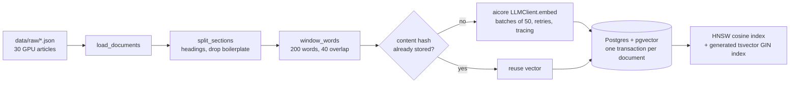

# DocuMind

Question answering over documents with cited sources, built as a RAG
(Retrieval-Augmented Generation) service.

**Stack:** Python 3.12, Flask, Postgres + pgvector, embeddings through
[`aicore`](../../packages/aicore) (Cloudflare Workers AI, BGE (BAAI General
Embedding) `bge-base-en-v1.5`).

_Status: M3 (golden dataset and retrieval evals) done. Hybrid retrieval,
cited answers and the API follow._

## Problem

An LLM (Large Language Model) can't answer reliably about documents it
has never seen, and it can't say where an answer came from. DocuMind
retrieves the relevant passages first and answers from them with
citations. So far this README covers turning a folder of documents into
searchable chunks, and measuring how well retrieval finds the right ones.

## Architecture (ingestion)



| Module | Job |
|---|---|
| `corpus.py` | Load and validate `{"title", "url", "text"}` JSON documents |
| `chunking.py` | Section-aware chunks; each is embedded as `Title > Section\ntext` |
| `pipeline.py` | Embed only unseen chunks; replace each document atomically |
| `store.py` | Schema, `init_db`, `PgChunkStore` (psycopg 3 async) |
| `retrieval.py` | `Retriever` protocol; `DenseRetriever` (query embedding + pgvector cosine) |
| `golden.py` | Golden dataset models, loader and quote validator |
| `metrics.py` | Hit rate@k, recall@k, MRR (Mean Reciprocal Rank) from evidence ranks |
| `evaluate.py` | Runs the golden questions through a retriever; table + saved JSON |
| `cli.py` | `documind init-db`, `documind ingest`, `documind eval` |

## How to run

```bash
# 1. Postgres with pgvector (from the repo root)
docker compose -f infra/docker-compose.yml up -d postgres

# 2. Configure: copy .env.example to .env, then set
#    AICORE_PROVIDER=cloudflare, AICORE_EMBED_MODEL=@cf/baai/bge-base-en-v1.5,
#    AICORE_API_KEY and AICORE_CLOUDFLARE_ACCOUNT_ID
uv sync --all-packages

# 3. Create the database and schema, then ingest
uv run documind init-db
uv run documind ingest

# 4. Score retrieval on the golden questions (dev split by default)
uv run documind eval --split dev
```

Tests: `uv run pytest projects/01-documind`. The integration tests
(`-m integration`) need Postgres running and skip themselves without it.
They use separate `documind_test` and `documind_e2e` databases with an
offline fake embedder, so they never touch real data or call Cloudflare.

## Ingestion numbers

Corpus: 30 documents, 105k words → **888 chunks** (median 124 words,
max 200).

| Run | Embedded | Reused | Embed calls |
|---|---|---|---|
| Fresh ingest (from an empty database) | 888 | 0 | 34 |
| Re-run, nothing changed | 0 | 888 | 0 |

Each embed call of up to 50 chunks took 0.2–0.5 s on Cloudflare Workers
AI. Re-runs are free: a chunk's vector is reused whenever its exact text
was embedded before, in any document.

**Chunk size was measured against the model limit.** BGE reads at most
512 tokens and silently drops the rest. The first version used 300-word
chunks. Embedding the longest chunks one per call showed some at exactly
512 tokens, so they were being truncated. Table-heavy sections run at
about 1.9 tokens per word. At 200 words the densest prose chunk is 400
tokens. See [ADR 0009](../../docs/adr/0009-documind-ingestion.md).

## Retrieval evals

`evals/golden.jsonl` holds 60 questions over the corpus: 40 dev (for
tuning) and 20 test (run once, at the end of M4). 44 are factual,
10 multi-hop (the answer needs passages from two documents) and 6
unanswerable (scored on refusal in M5, skipped here).

Each case names its evidence as a document title plus a short verbatim
quote, not a chunk id, so labels survive re-chunking. A chunk counts as
relevant when it is from that document and contains the quote. A unit
test checks every quote against the real chunks.


**Dense baseline (dev split, top 10 of 888 chunks):**

| Metric | All (36) | Factual (30) | Multi-hop (6) |
|---|---|---|---|
| Hit rate@1 | 0.67 (24/36) | 0.73 (22/30) | 0.33 (2/6) |
| Hit rate@3 | 0.89 (32/36) | 0.90 (27/30) | 0.83 (5/6) |
| Hit rate@5 | 0.94 (34/36) | 0.97 (29/30) | 0.83 (5/6) |
| Recall@10 | 0.93 | 0.97 | 0.75 |
| MRR@10 | 0.79 | 0.83 | 0.58 |

Latency per query (embedding call + pgvector search): p50 180 ms,
p95 304 ms.

Dense search almost always finds the answer in the top 5 but puts it
first only two times in three, and multi-hop questions are weakest.
Those are the numbers M4 (hybrid search and reranking) has to beat.
With 36 cases, one case is about 3 points, so raw counts are shown.
See [ADR 0010](../../docs/adr/0010-documind-golden-dataset-and-retrieval-evals.md).

## Design decisions

- **Chunks never cross a section heading**, and boilerplate (References,
  See also, External links) is dropped. One vector covers one topic.
- **40-word overlap**: a sentence cut at a window edge appears whole in
  the next chunk.
- **A header goes into the embedding**: `CUDA > History\n…` tells the
  model what "it was released in 2007" refers to.
- **Content-hash reuse plus delete-and-reinsert per document**: re-runs
  cost nothing, edits re-embed only the changed chunks, and a crash
  loses at most one document.
- **A generated `tsvector` column** is maintained by Postgres, ready for
  keyword and hybrid search in M4.
- **Queries are embedded as queries** (`input_type="query"`): BGE expects
  an instruction prefix on short queries but not on passages.
- **Misses are reviewed before the number is trusted.** One "miss" was the
  right fact in a document the label did not list; evidence can now name
  `alternatives`.

## Trade-offs and future work

- Word windows avoid a tokenizer dependency, but the safe size must be
  re-measured for denser corpora.
- Cloudflare bills a batch as (texts × longest text). Length-sorted
  batches would lower billed tokens; not needed on the free tier.
- 43 chunks under 20 words (table residue) are kept; M4 checks whether
  they crowd out useful chunks.
- The golden set is small and single-author (15 cases reviewed by a
  second person); confidence intervals are future work.
- Next: hybrid (keyword + vector, merged with RRF (Reciprocal Rank
  Fusion)) and reranked retrieval, measured against this baseline (M4).
