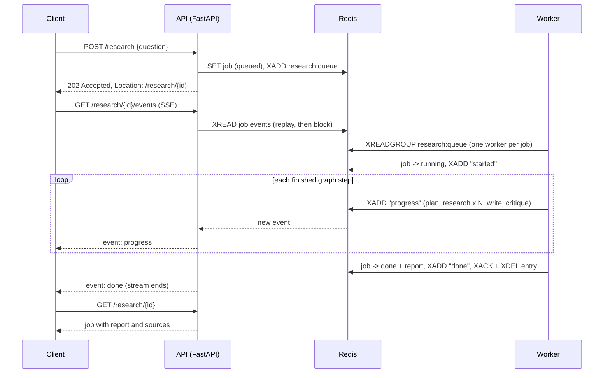
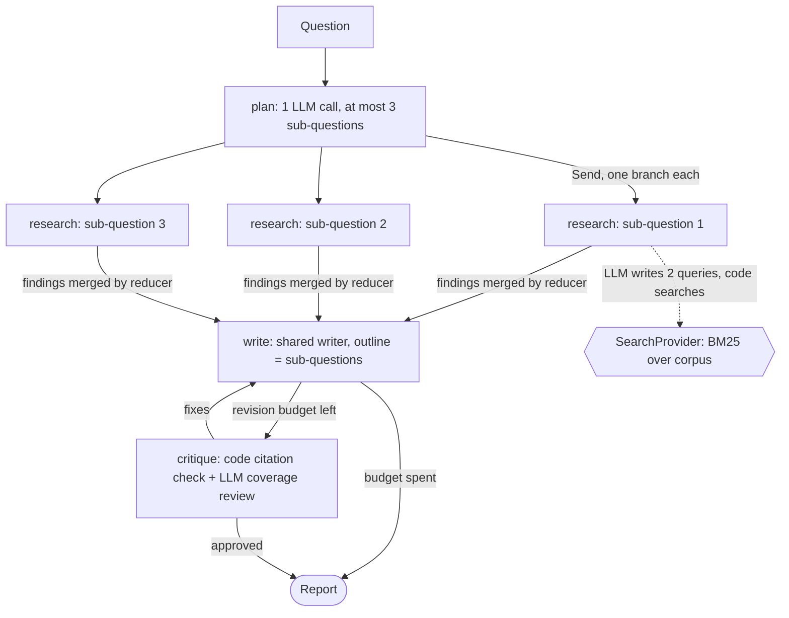

# Deep Research

**Stack:** FastAPI + LangGraph + Redis · **Status:** M3 of 3 done (research service)

A multi-agent research service: a planner splits a question into
sub-questions, researcher agents work on them in parallel, a writer
drafts a cited report and a critic sends it back for revision when it
is weak. It runs as an HTTP (Hypertext Transfer Protocol) service:
jobs go into a Redis queue, a worker runs them, and clients follow the
progress live over SSE (Server-Sent Events).

## Problem

Questions such as "Compare Chandrayaan-3 and Luna 25" or "How did the
Space Shuttle and Falcon 9 approach reusability?" need facts from
several documents. One search with the raw question finds some of them;
answering well means searching several times, from several angles, and
combining what was found. Agents can do that, but each agent step is
another LLM (Large Language Model) call, so the design has to prove the
extra calls buy better reports. M1 builds the measuring stick first.

## Milestones

| M | Scope | State |
|---|---|---|
| M1 | Corpus snapshot, search tool, golden dataset, eval runner, single-shot baseline | done |
| M2 | LangGraph agent graph: planner, parallel researchers, writer, critic with budgets | done |
| M3 | FastAPI service: Redis job queue, worker, SSE progress, Docker | done |

## Architecture

### Service

A report takes minutes, so the API never runs research inside a request.
It queues a job and answers at once; a separate worker does the work
(ADR 0017).



- **API** (`api.py`): stateless, it only reads and writes Redis, so any
  number of replicas can run.
- **Job store** (`jobs.py`): the queue is a Redis Stream read by one
  consumer group, so each job goes to exactly one worker. A worker
  acknowledges (`XACK`) a job only when it is finished; if the worker
  dies, the job stays pending and another worker claims it (`XAUTOCLAIM`)
  after the job timeout. Every state change is a check-and-set under
  `WATCH`, so a cancel and a finish cannot overwrite each other.
- **Worker** (`worker.py`): runs the graph under a hard timeout, polls
  for cancel requests, publishes each step to the job's event stream,
  and on SIGTERM hands its job straight back to the queue.

| Endpoint | Does |
|---|---|
| `POST /research` | queue a job; `202` + `Location`; `422` bad input; `429` + `Retry-After` when the queue is full |
| `GET /research/{id}` | status (`queued`, `running`, `done`, `failed`, `cancelled`), the report once done |
| `GET /research/{id}/events` | SSE: every event so far, then live ones, until the final one; resumes after `Last-Event-ID` |
| `DELETE /research/{id}` | cancel: at once if queued, within ~1 s if running; `409` if finished |
| `GET /healthz` | `200` if Redis answers, else `503` |

### Agent graph



Each research branch makes one LLM call to write keyword queries, then
code runs them through the search tool and merges the hits round-robin.
The LLM decides *what* to search, the code decides *that* it searches,
so every run is bounded: at most 7 LLM calls per report with the default
limits (ADR 0016).

- **Corpus** (`data/corpus/`): 38 Wikipedia articles on space
  agencies, rockets and missions, fetched once and committed. Research
  runs against this snapshot, so evals are reproducible and free (ADR
  0015).
- **Search** (`search.py`): agents only see `SearchProvider.search(query, k)`.
  `CorpusSearch` splits articles into ~120-word passages that never
  cross a section heading, and ranks them with BM25 (Best Matching 25,
  a keyword-ranking formula).
- **Agents** (`agents.py`): a LangGraph `StateGraph`. `Send` fans out
  one research branch per sub-question; an `operator.add` reducer
  merges their findings; conditional edges route the critique loop.
  Every structured step has a fallback, so a small model's bad JSON
  degrades quality instead of failing the run.
- **Writer** (`writer.py`): shared by the baseline and the agents, so a
  difference in eval numbers comes from planning and retrieval, not
  from different prompts.
- **Report** (`report.py`): both researchers return the same `Report`
  (text with `[n]` markers, numbered sources, the outline), so one eval
  scores both.
- **Baseline** (`baseline.py`): `single-shot` searches once with the raw
  question and makes one LLM call. It is the bar the agents must clear.

### Limits

| Setting (`DEEP_RESEARCH_*`) | Default | Caps |
|---|---|---|
| `MAX_SUB_QUESTIONS` | 3 | research branches |
| `QUERIES_PER_SUB_QUESTION` | 2 | searches per branch |
| `PASSAGES_PER_SUB_QUESTION` | 4 | sources per branch (12 in total at most) |
| `MAX_REVISIONS` | 1 | critique and rewrite rounds |
| `WORKER_CONCURRENCY` | 1 | jobs per worker process |
| `MAX_PENDING_JOBS` | 20 | queued + running jobs (then `429`) |
| `JOB_TIMEOUT_S` | 900 | run time of one job (then `failed`) |
| `RESULT_TTL_S` | 86400 | how long finished jobs and reports are kept |

## Evaluation

Each golden case is a research question with 3–6 **key facts**, each
tied to the article and verbatim quote that states it. A unit test
checks every quote is in the corpus.

| Metric | How it is measured |
|---|---|
| Key facts stated | LLM judge, one call per report, a verdict and reason per fact |
| Key facts retrieved | Code: the fact's quote is inside a retrieved passage |
| Expected documents retrieved | Code: the articles the facts come from were among the sources |
| Sentences with a citation | Code: the sentence carries a `[n]` marker |
| Cited sentences supported | LLM judge: the cited passage states what the sentence claims |

"Stated" vs "retrieved" separates a search miss from a writing miss.
Latency, LLM calls and cost per report are recorded, and judge cost is
kept separate.

### Results

Development runs use a local model, so these are smoke numbers, not
the official ones. Official numbers (all 13 cases, a fixed
`llama-3.3-70b` judge on Cloudflare) will replace them when quota allows.

**Smoke runs, 2026-11-18:** writer, agents and judge all `qwen2.5:3b`
on Ollama (CPU only), dev split, first 3 cases, `--max-claims 3`.
Correctness is not the goal of these runs: they show the system works
end to end and what it costs.

| Metric | single-shot | agents |
|---|---|---|
| Sentences with a citation | 0.00 (0/14) | **0.41 (9/22)** |
| Expected documents retrieved | 1.00 (7/7) | 1.00 (7/7) |
| Key facts retrieved (quote in a source) | 0.35 (6/17) | 0.24 (4/17), lower bound, see below |
| Key facts stated (judge) | 0.88 (15/17) | 1.00 (11/11) |
| LLM calls per report | 1 | 7 |
| Latency per report (p50) | 68 s | 249 s |
| Cost | $0 (local) | $0 (local) |

What the runs showed:

- **The critic loop works**: the code check flags uncited sentences and
  the rewrite adds citations (0% to 41% of sentences). A 3B writer still
  ignores the rule for most sentences.
- **"Facts retrieved" undercounts the agents.** It needs the exact
  golden quote inside a retrieved passage. The agents' queries often
  find a *different* passage stating the same fact (for example, Webb's
  launch date from its "Launch" section rather than the introduction),
  which does not count. Golden facts need alternative quotes, as in
  DocuMind, before this metric can compare the two systems.
- **The 3B judge is not reliable** (see M1): it accepted wrong facts
  and failed to return valid JSON for 7 of 7 support checks in the agents
  run. Judge rows are shown for completeness only.
- **Cost of agents**: 7 calls and about 3.7x the latency of one call, on
  a backend that runs one request at a time. On Cloudflare the three
  research branches would run at the same time.

### Service runs (M3)

**2026-11-18**, Docker Compose (API, worker and Redis containers),
worker on `qwen2.5:3b` via Ollama on the host (CPU only), agents
researcher. Each failure path was triggered for real, not only in unit
tests:

| Run | What was tested | Result | Submit to done |
|---|---|---|---|
| Luna 25 failure | happy path, live SSE, replay of a finished stream | `done`, 10 events, 6 sources | 167 s |
| Chandrayaan-3 vs Luna 25 | long idle gaps (keep-alives every 15 s) | `done`, 8 sources | 280 s |
| Luna 25 descent | `docker stop` (SIGTERM) right after planning | `requeued`, rerun by a new worker on the same SSE connection, `done` | 173 s |
| Luna 25 failure | worker died mid-job (no shutdown) | reclaimed by `XAUTOCLAIM` after 900 + 60 s idle, attempt 2, `done` | 1220 s |

API overhead is negligible next to the model: `POST /research` and
`GET /research/{id}` answer in milliseconds, and a job starts within
about a second of being queued when a worker is free. The run time is
the graph's 7 LLM calls.

Found by the real runs, not by fakeredis: redis-py's default 5 s socket
timeout broke idle blocking reads (fixed with a 30 s read timeout, and
an over-long idle wait now counts as "nothing new").

## How to run

```bash
uv sync --all-packages
uv run deep-research search "Luna 25 crash"          # BM25 only, no model
uv run deep-research ask "Compare Chandrayaan-3 and Luna 25"   # agents, prints each step
uv run deep-research ask "..." --researcher single-shot          # the baseline
uv run deep-research eval --researcher agents --split dev --limit 3
uv run deep-research eval --researcher single-shot --split dev --judge-model <model>
```

Models come from `AICORE_*` settings. For a local CPU-only run:

```bash
ollama pull qwen2.5:3b
AICORE_PROVIDER=ollama AICORE_MODEL=qwen2.5:3b AICORE_TIMEOUT_S=600 \
  uv run deep-research eval --researcher agents --split dev --limit 3 --max-claims 3
```

`uv run deep-research fetch-corpus` re-downloads any missing article.

### As a service (Docker, one command)

```bash
cd infra
docker compose up -d deep-research-worker     # builds the image, starts Redis + API + worker
curl -i -X POST localhost:8001/research -H 'content-type: application/json'   -d '{"question": "Why did the Luna 25 mission fail?"}'   # 202, Location: /research/<id>
curl -N localhost:8001/research/<id>/events    # live progress (SSE)
curl localhost:8001/research/<id>              # status and report
curl -X DELETE localhost:8001/research/<id>    # cancel
```

The worker reads model settings from the root `.env`; Ollama on the host
is reached at `host.docker.internal`. Interactive API docs:
`http://localhost:8001/docs`. Run more workers with
`docker compose up -d --scale deep-research-worker=3`.

Without Docker: `docker compose up -d redis`, then
`uv run uvicorn --factory deep_research.api:create_app --port 8001` and
`uv run deep-research worker` in two terminals.

## Trade-offs and future work

- **Own queue on Redis Streams, not Celery/Arq**: ~150 lines on Redis's
  own primitives (consumer group, pending list, claim), and the same
  streams carry progress for SSE. Worth replacing with a library once
  there are several task types (ADR 0017).
- **At-least-once delivery**: a job whose worker crashed reruns from the
  start. Safe, because research writes nothing outside Redis; a
  LangGraph checkpointer would resume instead.
- **Slow crash recovery**: a crashed worker's job is reclaimed after the
  job timeout plus 60 s (16 min by default). A heartbeat per running job
  would detect a dead worker in seconds.
- **No auth or per-user quotas**: required before exposing the API.

- **Snapshot, not the live web**: reproducible and free, but a narrower
  world than a real research agent's. A web search adapter goes behind
  the same `SearchProvider` protocol when the service is built.
- **BM25, not embeddings**: no model calls or vector store; weaker on
  paraphrase, which agents make up for by rephrasing queries.
- **LLM judges can be wrong**: every verdict is saved with a reason.
  Keep the judge model fixed when comparing runs.
- **13 questions is small**: sized for CPU-only runs; grow it before
  claiming small differences.
- **Fixed graph, not a free tool-calling agent**: bounded and testable,
  but it cannot go deeper on a hard question. The critic can only ask for
  a rewrite; letting it send gaps back to the researchers is the next
  step if evals show search is the bottleneck.
- **Parallel only with a parallel backend**: Ollama on CPU queues the
  research branches; on Cloudflare they overlap.
