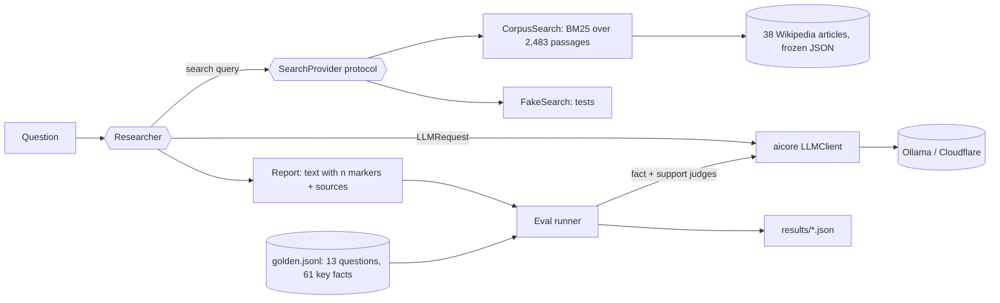

# Deep Research

**Stack:** FastAPI + LangGraph · **Status:** M1 of 4 done (evals and baseline)

A multi-agent research service: a planner splits a question into
sub-questions, researcher agents work on them in parallel, a writer
drafts a cited report and a critic sends it back for revision when it
is weak.

## Problem

Questions such as "Compare Chandrayaan-3 and Luna 25" or "How did the
Space Shuttle and Falcon 9 approach reusability?" need facts from
several documents. One search with the raw question finds some of them;
answering well means searching several times, from several angles, and
combining what was found. Agents can do that, but each agent step is
another LLM (Large Language Model) call, so the design has to prove the
extra calls buy better reports. M1 builds the measuring stick first.

## Milestones

| M | Scope | State |
|---|---|---|
| M1 | Corpus snapshot, search tool, golden dataset, eval runner, single-shot baseline | done |
| M2 | LangGraph agent graph: planner, parallel researchers, writer | next |
| M3 | Critic loop with limits (max revisions, token and cost budget) | |
| M4 | FastAPI service: background research jobs, streamed progress, Docker | |

## Architecture (M1)



- **Corpus** (`data/corpus/`): 38 Wikipedia articles on space
  agencies, rockets and missions, fetched once and committed. Research
  runs against this snapshot, so evals are reproducible and free (ADR
  0015).
- **Search** (`search.py`): agents only see `SearchProvider.search(query, k)`.
  `CorpusSearch` splits articles into ~120-word passages that never
  cross a section heading, and ranks them with BM25 (Best Matching 25,
  a keyword-ranking formula). A web search adapter can be added later
  without touching the agents.
- **Report** (`report.py`): every research system returns the same
  `Report` (text with `[n]` markers plus the numbered source passages),
  so the baseline and the agents are scored by the same eval.
- **Baseline** (`baseline.py`): `single-shot` searches once with the
  raw question and makes one LLM call. It is the bar the agents must clear.

## Evaluation

Each golden case is a research question with 3–6 **key facts**, each
tied to the article and verbatim quote that states it. A unit test
checks every quote is in the corpus.

| Metric | How it is measured |
|---|---|
| Key facts stated | LLM judge, one call per report, a verdict and reason per fact |
| Key facts retrieved | Code: the fact's quote is inside a retrieved passage |
| Expected documents retrieved | Code: the articles the facts come from were among the sources |
| Sentences with a citation | Code: the sentence carries a `[n]` marker |
| Cited sentences supported | LLM judge: the cited passage states what the sentence claims |

"Stated" vs "retrieved" separates a search miss from a writing miss.
Latency, LLM calls and cost per report are recorded, and judge cost is
kept separate.

### Results

Development runs use a local model, so these are smoke numbers, not
the official ones. Official numbers (all 13 cases, a fixed
`llama-3.3-70b` judge on Cloudflare) will replace them when quota allows.

**Smoke run, 2026-11-18:** `single-shot`, writer and judge both
`qwen2.5:3b` on Ollama (CPU only), dev split, first 3 cases,
`--max-claims 3`.

| Metric | Value |
|---|---|
| Key facts stated (judge) | 0.88 (15/17), **not trustworthy, see below** |
| Key facts retrieved (quote in a source) | 0.35 (6/17) |
| Expected documents retrieved | 1.00 (7/7) |
| Sentences with a citation | 0.00 (0/14) |
| Cited sentences supported (judge) | - (nothing cited) |
| Latency per report | p50 67.6 s, p95 80.3 s |
| LLM calls per report | 1 |
| Cost | $0 (local model) |

What the run showed:

- **The 3B writer ignores the citation rule**: 0 of 14 sentences carry
  a `[n]` marker. A fix belongs to the M2 writer agent, measured
  against this run.
- **The 3B judge is not reliable.** Spot-checking its saved reasons
  found it marking wrong facts as stated (a report said Webb is in a
  "sun-synchronous orbit" and that Chandrayaan-2 launched in 2018; both
  were accepted). "Stated" above "retrieved" (0.88 vs 0.35) is a second
  sign: the writer fills gaps from its own memory and the judge does not
  catch the errors. Judge numbers are only reported once a stronger
  judge model is used.
- **Search finds the right articles (7/7) but not the right passages
  (6/17 facts)**: one query with the raw question is too blunt. This is
  the gap M2's researcher agents (several focused queries) must close.

## How to run

```bash
uv sync --all-packages
uv run deep-research search "Luna 25 crash"          # BM25 only, no model
uv run deep-research ask "Compare Chandrayaan-3 and Luna 25"
uv run deep-research eval --split dev --limit 3      # small run
uv run deep-research eval --split dev --judge-model <model>
```

Models come from `AICORE_*` settings. For a local CPU-only run:

```bash
ollama pull qwen2.5:3b
AICORE_PROVIDER=ollama AICORE_MODEL=qwen2.5:3b AICORE_TIMEOUT_S=600 \
  uv run deep-research eval --split dev --limit 3 --max-claims 3
```

`uv run deep-research fetch-corpus` re-downloads any missing article.

## Trade-offs and future work

- **Snapshot, not the live web**: reproducible and free, but a narrower
  world than a real research agent's. A web search adapter goes behind
  the same `SearchProvider` protocol when the service is built.
- **BM25, not embeddings**: no model calls or vector store; weaker on
  paraphrase, which agents make up for by rephrasing queries.
- **LLM judges can be wrong**: every verdict is saved with a reason.
  Keep the judge model fixed when comparing runs.
- **13 questions is small**: sized for CPU-only runs; grow it before
  claiming small differences.
