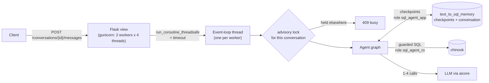
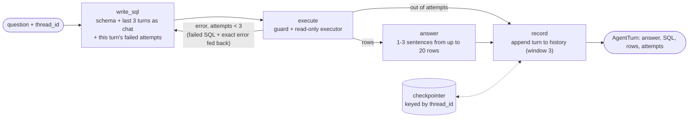
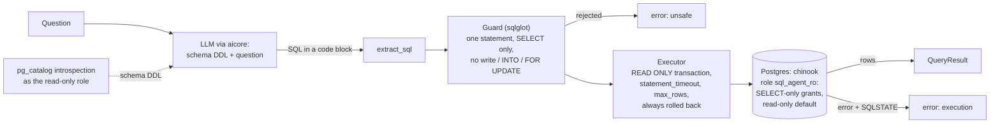
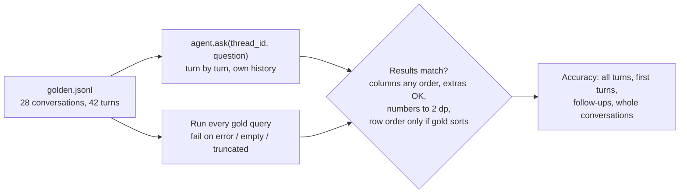

# Text-to-SQL Agent

**Stack:** Flask + LangGraph + PostgreSQL · **Status:** M3 of 3 done (chat API, durable memory, Docker)

A conversational chatbot over a SQL (Structured Query Language)
database: it answers questions in plain English, remembers the
conversation so follow-ups work, writes and runs read-only SQL and
repairs its own failed queries.

## Problem

Business users ask questions of data in conversations, not one-offs:
"What's revenue by country?", then "Only for 2024.", then "Now just the
top 3." The second and third questions mean nothing on their own. A
Text-to-SQL system therefore needs memory, and since it runs SQL that a
model wrote, it must be impossible for that SQL to change data, lock
rows or run forever. M1 built the measuring stick (golden
conversations, an execution-based eval and a baseline) and the safe
execution path; M2 added the agent (memory, self-correction and an
answer in words); M3 serves it as a chat API whose conversations live
in Postgres.

## Milestones

| M | Scope | State |
|---|---|---|
| M1 | Chinook database, read-only role, SQL guard, executor, golden conversations, execution-accuracy eval, single-shot baseline | done |
| M2 | LangGraph agent: conversation memory (checkpointer by thread id), write SQL, guard, execute, self-correct, answer | done |
| M3 | Flask chat API, Postgres checkpointer, connection pools, per-conversation lock, Docker one-command run | done |

## Architecture

### Chat API



- **Two databases, two roles, two pools.** The agent's SQL runs only as
  `sql_agent_ro` on `chinook`. Conversation memory (LangGraph's
  `AsyncPostgresSaver`) lives in `text_to_sql_memory`, owned by
  `sql_agent_app`, which cannot connect to `chinook`. The admin URL is
  only given to the one-shot init job.
- **Sync Flask, async everything else.** Each worker process runs one
  event-loop thread that owns the pools, the model client and the graph;
  views submit coroutines to it. Pools are shared by all requests,
  instead of a connection per request (ADR 0020).
- **One turn at a time per conversation**, across all workers: a
  Postgres advisory lock; a second message while one runs gets 409.
- Conversations survive restarts and can be continued by any worker.

| Endpoint | Returns |
|---|---|
| `POST /conversations` | 201 `{"id": "<uuid>"}` |
| `POST /conversations/{id}/messages` `{"question": "..."}` | 200 `answer`, `sql`, `columns`, `rows`, `truncated`, `attempts`, `error_kind`, `error`, `latency_ms` |
| `GET /conversations/{id}` | 200 remembered turns (question, SQL, row preview) |
| `GET /healthz` | 200 `{"chinook": true, "memory": true}`, or 503 |

Errors: 400 invalid body, 404 unknown conversation, 409 turn already
running, 413 body over 16 KB, 502 model failure, 503 database down,
504 turn over 120 s.

### Agent graph (one run per chat turn)



- **Memory:** a LangGraph checkpointer keeps each conversation's
  `history`. Earlier turns are replayed as chat messages: the question,
  then the SQL plus a 5-row preview as the assistant's reply. "Only for
  2024." is then answered by editing the previous query.
- **Self-correction:** guard rejections, Postgres errors and replies
  without SQL all go back as the next message ("That query failed:
  column t.title does not exist (SQLSTATE 42703)"). Generate and repair
  are one node, so a repair sees the whole conversation.
- **Budget:** at most 3 SQL attempts + 1 answer call per turn
  (`TEXT_TO_SQL_MAX_ATTEMPTS`, `TEXT_TO_SQL_HISTORY_TURNS`). An empty
  result or a turn out of attempts gets a reply written in code, with no
  call.
- The CLI and eval use the in-process `InMemorySaver`; the API uses the
  Postgres checkpointer (ADR 0019, 0020).

### Safe execution

Three layers keep model-written SQL harmless, each enforced by a
different component (ADR 0018):



| Layer | Enforced by | Stops | Why it is there |
|---|---|---|---|
| Role `sql_agent_ro` | Postgres grants | every write, CREATE, TEMP | the security boundary, whatever the SQL says |
| Guard | `guard.py` (sqlglot parser) | multiple statements, non-SELECT, `WITH ... DELETE`, `SELECT INTO`, `FOR UPDATE` | a clear early error the model can act on; defence in depth |
| Executor | `executor.py` | runaway queries, huge results | timeout and row cap per query; does not trust the role's defaults |

Integration tests prove each layer holds on its own, with the layers in
front of it bypassed.

The eval drives the agent like a chat client: a fresh thread id per
conversation, then each question in order.



## How to run

**One command (Docker):** starts Postgres, runs the init job (Chinook,
read-only role, memory database) and serves the API on port 8002. The
model comes from `AICORE_*` in `.env`.

```bash
docker compose -f infra/docker-compose.yml up text-to-sql-api

# Local Ollama instead of .env's provider:
docker compose -f infra/docker-compose.yml run --rm --service-ports   -e AICORE_PROVIDER=ollama -e AICORE_MODEL=qwen2.5:3b -e AICORE_TIMEOUT_S=600   text-to-sql-api
```

```bash
ID=$(curl -s -X POST localhost:8002/conversations | jq -r .id)
curl -s localhost:8002/conversations/$ID/messages -H 'Content-Type: application/json'   -d '{"question": "What is the total revenue for each billing country?"}' | jq .answer
curl -s localhost:8002/conversations/$ID/messages -H 'Content-Type: application/json'   -d '{"question": "Only for 2024."}' | jq .sql
curl -s localhost:8002/conversations/$ID | jq '.turns[].question'
```

**Without Docker (CLI, eval):**

```bash
uv sync --all-packages
docker compose -f infra/docker-compose.yml up -d postgres
uv run text-to-sql load-db            # chinook database + read-only role (idempotent)
uv run text-to-sql init-memory        # memory database + role + checkpoint tables (for the API)
uv run text-to-sql check-golden       # every gold query runs and returns rows
uv run text-to-sql schema             # the schema exactly as the model sees it

# Local model (no API key); or set AICORE_* for Cloudflare
export AICORE_PROVIDER=ollama AICORE_MODEL=qwen2.5:3b AICORE_TIMEOUT_S=600
uv run text-to-sql chat                # a conversation; empty line to quit
uv run text-to-sql ask "Which 3 artists have the most albums?"
uv run text-to-sql eval --agent agent --split test        # or --agent single-shot
uv run text-to-sql eval --agent agent --split dev --limit 4   # ~1-3 min smoke run
```

Results are saved to `evals/results/{agent}-{split}.json`.

## Golden dataset

`evals/golden.jsonl`: 20 single questions and 8 conversations of 2–3
turns (17 dev / 11 test conversations). Each turn has hand-written gold
SQL and tags (`join`, `aggregate`, `order-limit`, `date`, `follow-up`,
`ellipsis` for "What about Blues?", `reference` for "their average
price"). A follow-up's gold SQL is the full query it means. Gold queries
avoid ties at a `LIMIT`, so every answer is unambiguous.

## Eval results

### M3: the API, measured

A 3-turn conversation over HTTP in Docker (gunicorn, local
`qwen2.5:3b` on CPU via the host's Ollama):

| Turn | Result | Latency |
|---|---|---|
| "What is the total revenue for each billing country?" | 24 rows, correct | 53.7 s |
| "Only for 2024." | same query + 2024 filter, correct rows | 51.2 s |
| "Now just the top 3 countries, highest first." | USA 127.98, Brazil 53.46, Canada 42.57 (= gold) | 39.7 s |
| A message sent while turn 2 ran | 409 busy | immediate |
| `GET` the conversation after `docker restart` | all 3 turns remembered | - |

The very first request after Ollama loaded the model took over 120 s
and got a 504; the timeout cancelled the turn and released its lock, so
the next message went through. A hosted model answers in seconds. The
turn-2 answer text skipped Brazil (unsorted rows, 3B model) while its
rows were right: answers are not graded yet.

### M2: agent vs baseline, held-out test split

Same 11 conversations (16 turns), local `qwen2.5:3b` on CPU, baseline
prompt v1, agent prompt v1 (`evals/results/*-test.json`):

| Metric | single-shot | agent |
|---|---|---|
| Execution accuracy, all turns | 0.62 (10/16) | **0.69 (11/16)** |
| First turns (stand-alone questions) | **0.91 (10/11)** | 0.82 (9/11) |
| Follow-up turns | 0.00 (0/5) | **0.40 (2/5)** |
| Conversations fully correct (2+ turns) | 0.00 (0/3) | **0.33 (1/3)** |
| Turns whose SQL ran | 0.94 (15/16) | **1.00 (16/16)** |
| Turns that ran only after a repair | - | 1/16 |
| LLM calls per turn | 1.0 | 1.9 (1.1 SQL attempts + answer) |
| Latency per turn | p50 12.2 s, p95 34.7 s | p50 20.7 s, p95 89.7 s |
| Cost per turn | $0 (local) | $0 (local) |

Reading it (16 turns is a small sample; one turn moves a rate by 6 points):

- **Memory is the gain.** Follow-ups went from 0/5 to 2/5: "Show the
  same, but count the tracks sold instead." and "And in 2023?" now edit
  the previous query. The baseline answered them as unrelated questions
  (albums; artists).
- **Every query ran** (16/16): the one baseline execution error class
  (`timestamp ~~ unknown`, `LIKE` on a date) did not recur, and one turn
  was rescued by a repair.
- **The stand-alone drop is one question** (s14): the agent used a
  `LEFT JOIN`, so employees with no customers appear with 0, an extra
  row. Arguably a valid reading; the gold query counts only agents with
  customers.
- **What still fails is not fixable by memory or repair**:
  - c08 ("Which employees are sales support agents?") fails on turn 1 in
    both: the model never sees that `employee.title` holds the value
    `'Sales Support Agent'`, so it searches `first_name LIKE '%Sales%'`,
    and the two follow-ups inherit the wrong filter (own-history
    scoring). Fix: show a few distinct values for short text columns in
    the schema.
  - c07.2 ("How much revenue did *they* bring in?") dropped the 2022
    filter from the turn before. A 3B model resolving "they"; a
    stronger model is the first thing to try.
- **Cost of the gain:** about 2 calls and 1.7x the median latency per
  turn, mostly the answer call. p95 is a turn with a repair plus a long
  answer on CPU.

### M1: baseline on the dev split

Baseline `single-shot` (schema in the prompt, one call, no memory, no
retries), dev split, local `qwen2.5:3b` on CPU, prompt v1
(`evals/results/single-shot-dev.json`):

| Metric | single-shot |
|---|---|
| Execution accuracy, all turns | 0.58 (15/26) |
| First turns (stand-alone questions) | 0.82 (14/17) |
| Follow-up turns | 0.11 (1/9) |
| Conversations fully correct (2+ turns) | 0.20 (1/5) |
| Turns whose SQL ran | 0.81 (21/26) |
| Errors | 4 execution, 1 rejected by the guard, 0 without SQL |
| Latency per turn | p50 7.6 s, p95 14.4 s |
| LLM calls / cost per turn | 1.0 / $0 (local) |

What the failures say about M2:

- **Follow-ups fail without memory, as expected.** "Only for 2024."
  became a query about artists; "What about Blues?" listed tracks
  instead of counting them. The one follow-up that passed ("Only the
  countries with more than 3 customers.") happens to be answerable on
  its own. This is the case for conversation memory.
- **4 of 5 errors are fixable from Postgres's own message**:
  `column t.title does not exist`, `column reference "album_id" is
  ambiguous`. This is the case for a self-correction loop that feeds the
  error back.
- One reply used a placeholder (`customer_id = <customer_id>`), which
  the guard rejected as unparseable before it reached the database.

The test split was held back for the M2 comparison above.

## Trade-offs and future work

- **Whole schema in the prompt.** Chinook's 11 tables fit easily; a
  warehouse with hundreds of tables needs schema selection first.
- **Relaxed matching** (extra columns allowed) can rarely pass a wrong
  answer such as `SELECT *`; the saved SQL makes that auditable.
- **3B local model.** Numbers show the shape, not final quality; rerun
  with a stronger model once the Cloudflare quota allows.
- **Column values are not in the prompt** (see c08 above): adding a few
  distinct values for low-cardinality text columns is the next quality
  step.
- **Repair only catches failures.** A query that runs and returns the
  wrong rows is not detected; that needs a checker call per turn.
- **Answers are not graded yet**: the eval scores rows, not the prose.
- **API not built yet:** authentication and per-user conversations,
  rate limiting, deleting conversations, trimming old checkpoints (the
  saver keeps every checkpoint), streaming the answer.
