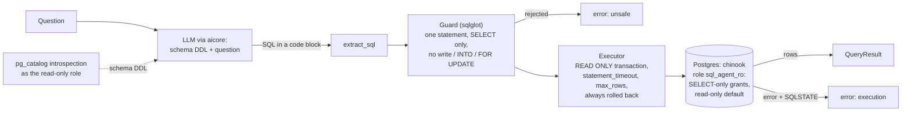
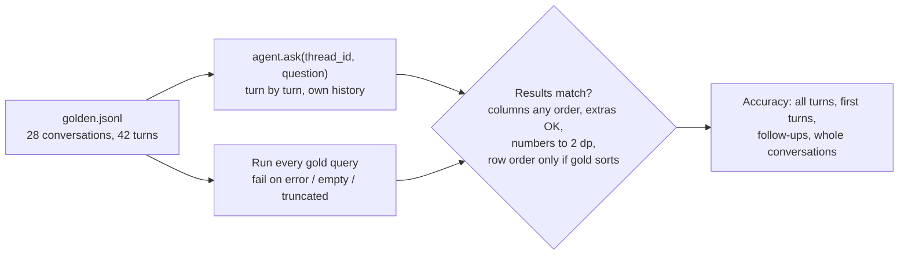

# Text-to-SQL Agent

**Stack:** Flask + LangGraph + PostgreSQL · **Status:** M1 of 3 done (database, safe execution, evals, baseline)

A conversational chatbot over a SQL (Structured Query Language)
database: it answers questions in plain English, remembers the
conversation so follow-ups work, writes and runs read-only SQL and
repairs its own failed queries.

## Problem

Business users ask questions of data in conversations, not one-offs:
"What's revenue by country?", then "Only for 2024.", then "Now just the
top 3." The second and third questions mean nothing on their own. A
Text-to-SQL system therefore needs memory, and since it runs SQL that a
model wrote, it must be impossible for that SQL to change data, lock
rows or run forever. M1 builds the measuring stick (golden
conversations, an execution-based eval and a baseline) and the safe
execution path everything else will use.

## Milestones

| M | Scope | State |
|---|---|---|
| M1 | Chinook database, read-only role, SQL guard, executor, golden conversations, execution-accuracy eval, single-shot baseline | done |
| M2 | LangGraph agent: conversation memory (checkpointer by thread id), generate, guard, execute, self-correct, answer | next |
| M3 | Flask chat API with sessions, connection pool, Docker one-command run | |

## Architecture

Three layers keep model-written SQL harmless, each enforced by a
different component (ADR 0018):



| Layer | Enforced by | Stops | Why it is there |
|---|---|---|---|
| Role `sql_agent_ro` | Postgres grants | every write, CREATE, TEMP | the security boundary, whatever the SQL says |
| Guard | `guard.py` (sqlglot parser) | multiple statements, non-SELECT, `WITH ... DELETE`, `SELECT INTO`, `FOR UPDATE` | a clear early error the model can act on; defence in depth |
| Executor | `executor.py` | runaway queries, huge results | timeout and row cap per query; does not trust the role's defaults |

Integration tests prove each layer holds on its own, with the layers in
front of it bypassed.

The eval drives the agent like a chat client: a fresh thread id per
conversation, then each question in order.



## How to run

```bash
uv sync --all-packages
docker compose -f infra/docker-compose.yml up -d postgres
uv run text-to-sql load-db            # chinook database + read-only role (idempotent)
uv run text-to-sql check-golden       # every gold query runs and returns rows
uv run text-to-sql schema             # the schema exactly as the model sees it

# Local model (no API key); or set AICORE_* for Cloudflare
export AICORE_PROVIDER=ollama AICORE_MODEL=qwen2.5:3b AICORE_TIMEOUT_S=600
uv run text-to-sql ask "Which 3 artists have the most albums?"
uv run text-to-sql eval --split dev   # --limit N for the first N conversations
```

Results are saved to `evals/results/{agent}-{split}.json`.

## Golden dataset

`evals/golden.jsonl`: 20 single questions and 8 conversations of 2–3
turns (17 dev / 11 test conversations). Each turn has hand-written gold
SQL and tags (`join`, `aggregate`, `order-limit`, `date`, `follow-up`,
`ellipsis` for "What about Blues?", `reference` for "their average
price"). A follow-up's gold SQL is the full query it means. Gold queries
avoid ties at a `LIMIT`, so every answer is unambiguous.

## Eval results

Baseline `single-shot` (schema in the prompt, one call, no memory, no
retries), dev split, local `qwen2.5:3b` on CPU, prompt v1
(`evals/results/single-shot-dev.json`):

| Metric | single-shot |
|---|---|
| Execution accuracy, all turns | 0.58 (15/26) |
| First turns (stand-alone questions) | 0.82 (14/17) |
| Follow-up turns | 0.11 (1/9) |
| Conversations fully correct (2+ turns) | 0.20 (1/5) |
| Turns whose SQL ran | 0.81 (21/26) |
| Errors | 4 execution, 1 rejected by the guard, 0 without SQL |
| Latency per turn | p50 7.6 s, p95 14.4 s |
| LLM calls / cost per turn | 1.0 / $0 (local) |

What the failures say about M2:

- **Follow-ups fail without memory, as expected.** "Only for 2024."
  became a query about artists; "What about Blues?" listed tracks
  instead of counting them. The one follow-up that passed ("Only the
  countries with more than 3 customers.") happens to be answerable on
  its own. This is the case for conversation memory.
- **4 of 5 errors are fixable from Postgres's own message**:
  `column t.title does not exist`, `column reference "album_id" is
  ambiguous`. This is the case for a self-correction loop that feeds the
  error back.
- One reply used a placeholder (`customer_id = <customer_id>`), which
  the guard rejected as unparseable before it reached the database.

The test split (11 conversations) is held back for the M2 comparison.

## Trade-offs and future work

- **Whole schema in the prompt.** Chinook's 11 tables fit easily; a
  warehouse with hundreds of tables needs schema selection first.
- **Relaxed matching** (extra columns allowed) can rarely pass a wrong
  answer such as `SELECT *`; the saved SQL makes that auditable.
- **A connection per query** is fine for the CLI and eval; the M3 API
  will use a pool.
- **3B local model.** Numbers show the shape, not final quality; rerun
  with a stronger model once the Cloudflare quota allows.
- Next (M2): conversation memory, self-correction from guard and
  Postgres errors, and a plain-English answer for each result.
